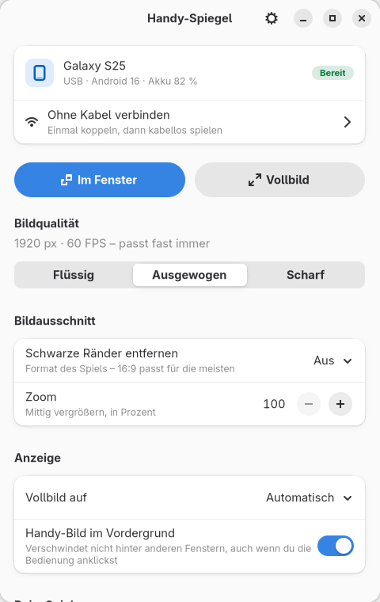
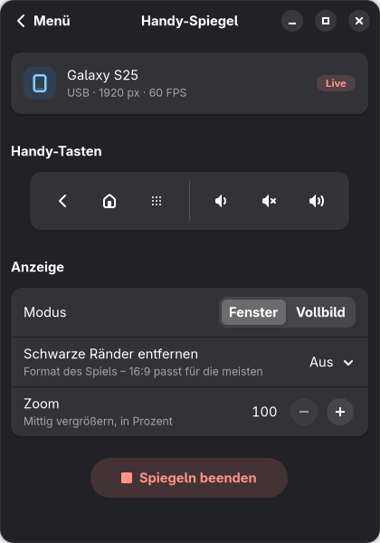
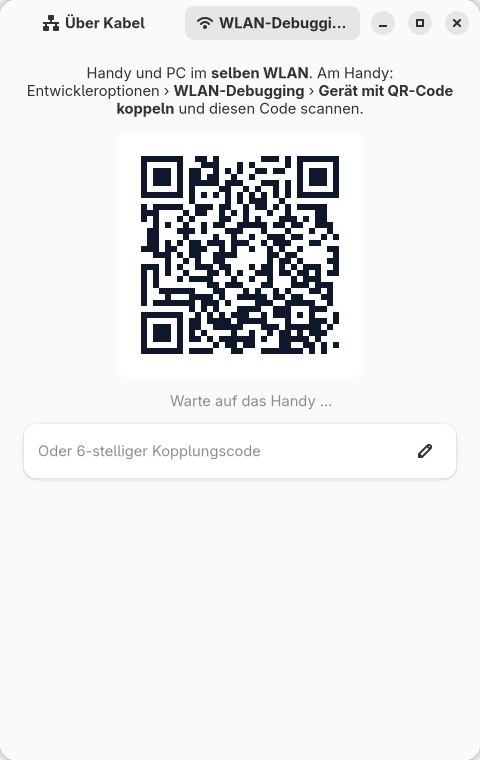
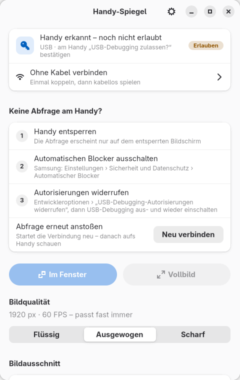

<!-- readme-kopf:anfang (erzeugt: dev/readme-kopf.py) -->
<p align="center">
  <picture>
    <source media="(prefers-color-scheme: dark)" srcset="https://raw.githubusercontent.com/Janeway-Technology/.github/main/assets/wortmarken/janeway-handy-spiegel-dunkel.svg">
    
  </picture>
</p>

<p align="center"><b>Android-Handy auf PC oder Fernseher spiegeln, mit wenig Verzögerung, Controller und ohne Kabel (GTK4-Oberfläche für scrcpy)</b></p>

<p align="center"><a href="https://github.com/Janeway-Technology">Janeway Technology</a> › <a href="https://github.com/Janeway-Technology/janeway-sonstige">Sonstige</a> › Handy-Spiegel</p>
<!-- readme-kopf:ende -->

<div align="center">


**Dein Android-Handy auf dem PC oder Fernseher, mit minimaler Verzögerung.**<br>
Handyspiele auf dem großen Bildschirm spielen, mit Maus, Tastatur oder Controller.

[](https://github.com/Janeway-Technology/handy-spiegel/releases/latest)


&nbsp;&nbsp;

</div>

---

## Was kann's?

| | |
|---|---|
| ⚡ **Wenig Verzögerung** | H.264 ohne Bildpuffer, Ton über USB unkomprimiert (30 ms Puffer) |
| 🎮 **Controller** | Am PC angeschlossene Controller steuern direkt das Handy |
| 📺 **Vollbild auf dem TV** | Nimmt automatisch den *anderen* Bildschirm, die Bedienung bleibt sichtbar |
| ✂️ **Schwarze Ränder weg** | Format 16:9 / 18:9 / 20:9 / 4:3 plus Zoom, direkt am Handy zugeschnitten, spart sogar Bandbreite |
| 📶 **Ohne Kabel** | Einmal per USB koppeln (klappt auch, wenn das Handy den Hotspot macht) oder per QR-Code über WLAN-Debugging |
| 🕹️ **Steuerleiste** | Zurück, Home, Übersicht, Lautstärke, Fenster ↔ Vollbild, live umschaltbar |
| 🔋 **Akku schonen** | Handy-Display aus, Touch und Spiel laufen weiter |
| 📦 **Ein einziges AppImage** | scrcpy und adb sind eingebaut, auf dem Ziel-PC muss nichts installiert werden |

## Schnellstart

1. **AppImage laden:** [Handy-Spiegel-x86_64.AppImage](https://github.com/Janeway-Technology/handy-spiegel/releases/latest)
2. Ausführbar machen und starten:
   ```bash
   chmod +x Handy-Spiegel-x86_64.AppImage
   ./Handy-Spiegel-x86_64.AppImage
   ```
3. **Am Handy einmalig USB-Debugging einschalten:**
   - Einstellungen › Telefoninfo › Softwareinformationen › **7× auf „Buildnummer“** tippen
   - Einstellungen › Entwickleroptionen › **USB-Debugging** an
4. Handy per USB anschließen und am Handy **„Immer zulassen“** bestätigen.
5. **Im Fenster** oder **Vollbild** drücken: fertig.

> **Ins App-Menü übernehmen:** Repo klonen und `bash install.sh Pfad/zum/AppImage` ausführen.

## Ohne Kabel spielen



**Über Kabel koppeln**, geht mit jedem Android, auch wenn der PC am Hotspot des Handys hängt:
Handy einstecken › *Ohne Kabel verbinden* › *Jetzt koppeln* › Kabel ab.
Nach einem Neustart des Handys einmal wiederholen.

**WLAN-Debugging** (Android 11+), ganz ohne Kabel, Handy und PC im selben WLAN:
Entwickleroptionen › *WLAN-Debugging* › *Gerät mit QR-Code koppeln* und den Code in der App scannen.

Gekoppelte Handys verbinden sich danach automatisch.

<br clear="right">

## Tastenkürzel im Handy-Fenster

| Taste | Wirkung |
|---|---|
| Rechtsklick | Zurück |
| Mittelklick | Home |
| `Alt` + `F` | Vollbild an/aus |
| `Alt` + `O` | Handy-Display aus (`Alt`+`Shift`+`O` wieder an) |
| `Alt` + `R` | Drehen |
| `Alt` + `↑` / `↓` | Lautstärke |

## Probleme?



**„Handy erkannt, noch nicht erlaubt“, aber am Handy kommt keine Abfrage**
- Handy entsperren: die Abfrage erscheint nur auf dem entsperrten Bildschirm
- Samsung: *Einstellungen › Sicherheit und Datenschutz › Automatischer Blocker* ausschalten
- Entwickleroptionen › *USB-Debugging-Autorisierungen widerrufen*, USB-Debugging aus und wieder an
- In der App auf **Neu verbinden** drücken

**Kein Ton**, Ton-Weiterleitung braucht Android 11 oder neuer.

**Ruckelt**, Bildqualität auf *Flüssig* stellen, über USB statt WLAN spielen.

**Fenster ist weg**, das Handy-Bild hängt im Dock am Handy-Spiegel-Symbol. Mit *Handy-Bild im Vordergrund* bleibt es immer sichtbar.

<br clear="right">

## Selbst bauen

Benötigt Rust, GTK ≥ 4.12 und libadwaita ≥ 1.7 (Entwicklerpakete).

```bash
git clone https://github.com/Janeway-Technology/handy-spiegel
cd handy-spiegel
cargo build --release            # nur die App, nutzt scrcpy/adb aus dem System
bash build-appimage.sh           # komplettes AppImage inkl. scrcpy + adb, installiert es auch
```

`build-appimage.sh` lädt den offiziellen statischen scrcpy-Build, linuxdeploy und appimagetool selbst herunter.

**Vorschau ohne Handy**, praktisch für Design-Arbeit:
```bash
HANDY_SPIEGEL_DEMO=ok    target/release/handy-spiegel   # auch: none, auth, live, wifi, wifiqr, settings
```

## Wie es funktioniert

Handy-Spiegel ist eine GTK4/libadwaita-Oberfläche in Rust für [scrcpy](https://github.com/Genymobile/scrcpy).
Die App findet Geräte über `adb`, liest Name, Android-Version, Akku und Displaygröße aus und startet scrcpy mit auf Latenz getrimmten Optionen (`--video-buffer=0`, H.264, Raw-Audio über USB, `--crop` für das Ränder-Entfernen). Tasten der Steuerleiste gehen per `adb shell input keyevent` ans Handy.

## Lizenz

Der Code dieses Projekts steht unter der [MIT-Lizenz](LICENSE).

Das AppImage enthält Software Dritter mit eigenen Lizenzen:
[scrcpy](https://github.com/Genymobile/scrcpy) (Apache-2.0),
Android Platform Tools / adb (Apache-2.0),
GTK und libadwaita (LGPL-2.1+),
Adwaita-Symbole (CC-BY-SA-3.0 / LGPL-3.0).

Android ist eine Marke von Google LLC. Dieses Projekt steht in keiner Verbindung zu Google oder Samsung.
